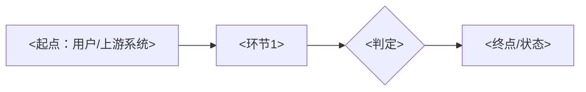
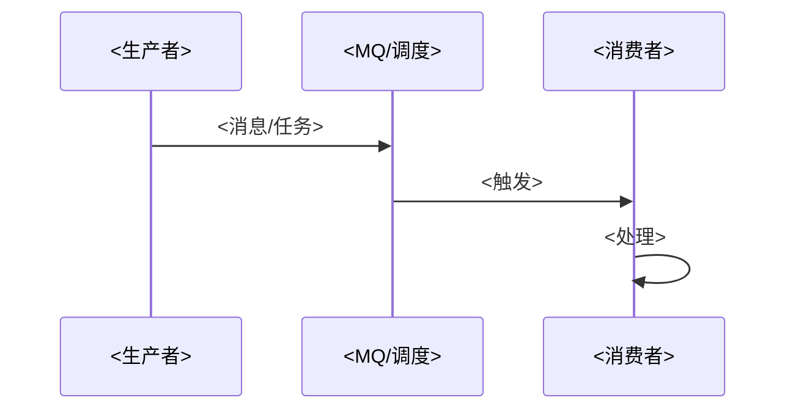
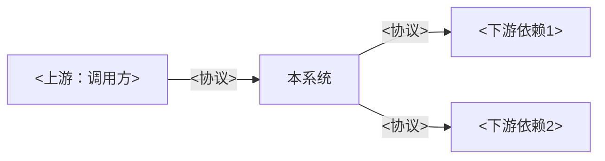
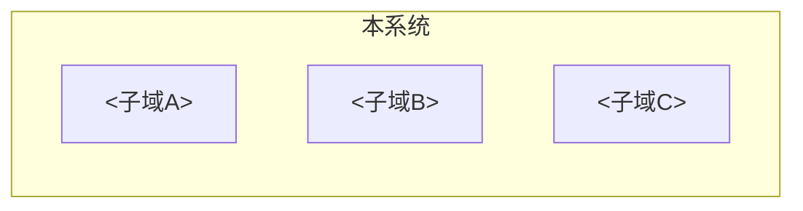
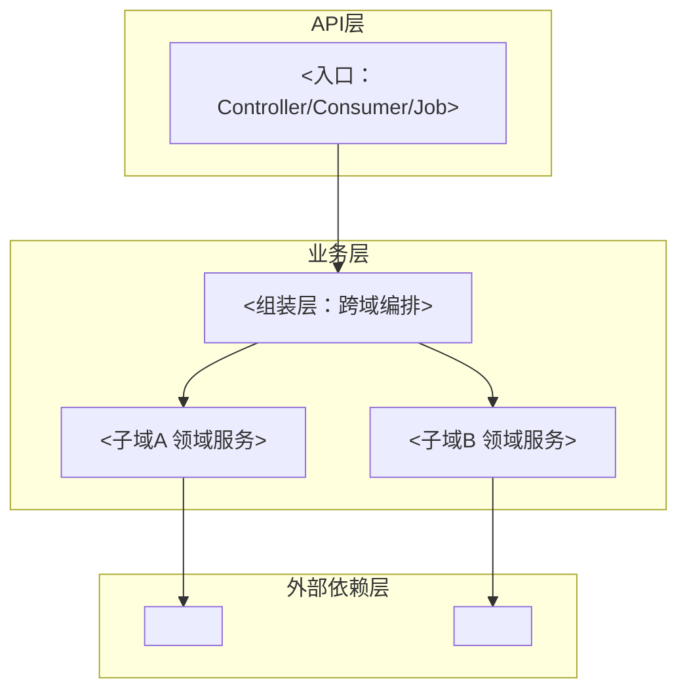
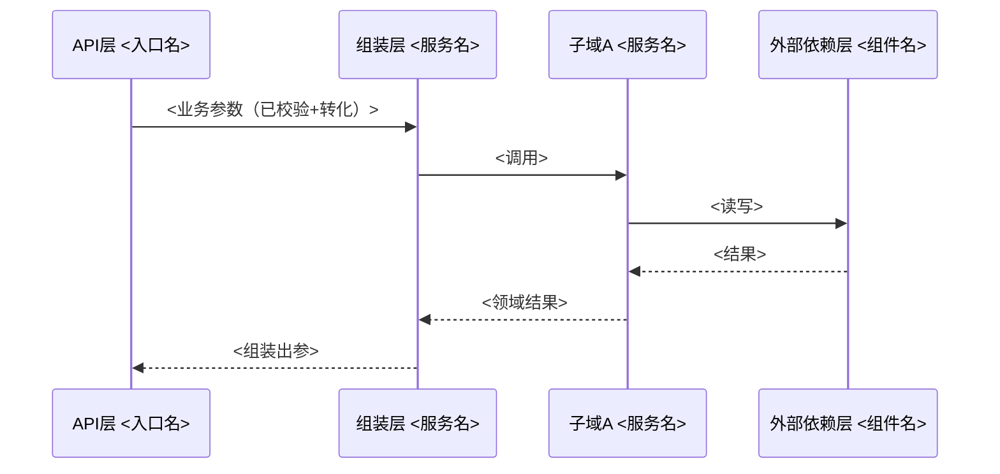

# 技术设计 — <需求标题>

<!--
设计文档纪律（必须遵守）：
1. 正文始终只保留最终态，禁止「CHG-NN 改了什么」式过程结论；过程记录留在 changes/CHANGES.md、04-review.md、06-cr-report.md
2. 保持清爽：图优先（流程图/时序图/UML/ER），文字只写必要说明；删除任何对理解最终实现无帮助的段落
3. 固定七个部分 + 附录，顺序不可调；不适用的小节写「无 + 一句理由」，不得删除章节
4. 目标：代码与设计 1:1 还原，任何人只看本文档即得最终实现
-->

## 一、需求背景

<!-- 一段话说清：业务背景、要达成什么目标、本期范围（做什么/不做什么）。细节链接 02-clarification.md，不复制粘贴 -->

<背景与目标，≤5 句>

- 范围：<In Scope 一句话>；不做：<Out of Scope 一句话>
- 验收标准：见 `02-clarification.md`（AC-01 ~ AC-NN）

## 二、业务流程

<!--
读者：业务、产品、研发、测试。目的：让所有人看清业务如何流转、本期要实现哪些业务功能、上下游调用链路。
以图为准，文字只做图的注脚。正向/逆向/异步流程缺一不可（无则写「无」）。
-->

### 2.1 正向流程

<!-- 主业务链路，mermaid 流程图或时序图，标注关键分支与状态变化 -->



### 2.2 逆向流程

<!-- 退款/取消/回滚/补偿链路；无则写「无」 -->


### 2.3 异步流程

<!-- MQ 消息、定时任务、领域事件驱动的链路；无则写「无」 -->



### 2.4 上下游调用链路

<!-- 本系统与上游调用方、下游依赖方（DB/缓存/RPC/MQ）的全貌图；标注协议与方向 -->



## 三、领域划分

<!-- 基于第二部分流程梳理 + 后续扩展性，划分子域。图文结合：先给划分图，再给子域表 -->

### 3.1 领域划分图



### 3.2 子域说明

<!-- 每个子域：定位（解决什么问题）、划分依据（为什么是独立子域）、核心职责（一句话） -->

| 子域 | 定位 | 划分依据 | 核心职责 |
| --- | --- | --- | --- |
| <子域A> | <定位> | <依据：业务语义/变更频率/扩展方向> | <职责> |

## 四、实体设计

<!-- 基于子域梳理实体，说清实体之间的关系（1:1 / 1:N / N:N、归属、引用） -->

### 4.1 实体关系图

```mermaid
erDiagram
  <实体A> ||--o{ <实体B> : <关系>
```

### 4.2 实体说明

| 实体 | 所属子域 | 职责 | 关键属性 | 与其他实体的关系 |
| --- | --- | --- | --- | --- |
| <实体A> | <子域A> | <一句话> | <核心字段，非全量> | <如：1:N 关联实体B> |

## 五、数据建模

<!-- 基于实体的表设计，图文结合：先 UML 表关系图，再逐表详细字段 -->

### 5.1 表关系图（UML）

```mermaid
erDiagram
  <table_a> ||--o{ <table_b> : "<外键关系>"
  <table_a> {
    bigint id PK
    varchar <field>
  }
```

### 5.2 表：<table_name>

<!-- 逐表列出；含表用途一句话、字段明细、索引 -->

用途：<一句话>

| 字段 | 类型 | 说明 | 备注 |
| --- | --- | --- | --- |
| id | BIGINT | 主键 | 自增/序列 |
| <field> | <类型> | <含义> | <枚举口径/单位/默认值> |

| 索引名 | 字段 | 唯一 |
| --- | --- | --- |
| <索引名> | <字段> | <是/否> |

## 六、落地实现

<!--
读者：研发、测试。目的：照此开发不出错。
分层铁律：层名与层序由本节声明（默认 API 层（校验+防腐+转化）→ 业务层（业务编排）→ 领域层（子域领域逻辑与可复用能力）→ 外部依赖层（转化+防腐、无业务逻辑、通用）；**层数上限 5 层**）；只允许上层调下层，禁循环依赖；下层不做冗余校验。
域间铁律：**同层跨子域禁止互相调用**（如用户域不允许调权益域）；**层层复用**：任一层可组装任意下层子域能力（业务层可组装多个领域层子域）；跨域协作必须在上层编排；子域间确需协作只经领域事件或「下层定义接口 + 上层注入实现（SPI）」。
-->

### 6.1 分层架构图

<!-- 按域 × 层组织模块；标注每个模块归属的层与域 -->



### 6.2 数据流转图

<!-- 每个核心流程一张时序图：从入口穿透到外部依赖层，标注层与域的边界、事务范围 -->



### 6.3 接口契约

<!-- 对外接口逐个定义；幂等性约定必填 -->

| 接口 | 方法 | 入参 | 出参 | 错误码 | 幂等性 |
| --- | --- | --- | --- | --- | --- |
| <接口路径/名称> | <GET/POST/...> | <参数列表> | <返回结构> | <错误码与含义> | <幂等机制> |

### 6.4 配置清单

<!-- EP-01 门禁：逐项列明；分界判据=变动概率（HC-14：初期不确定/需运行期调整→ducc；稳定值→properties；中间件参数→XML+properties，HC-12） -->

| 配置项 | 位置（properties/ducc/中间件XML） | 默认值 | 用途 | 是否运行期可调 | 变更影响 |
| --- | --- | --- | --- | --- | --- |
| <配置项名> | <位置> | <默认值> | <用途> | <是/否> | <影响面> |

## 七、边界场景

<!-- 需要注意的边界与异常，逐条写清应对；这是开发与测试的重点关注区，不得留空 -->

| 场景 | 类型（边界/并发/幂等/超时/重试/重复投递/兼容/其他） | 应对策略 |
| --- | --- | --- |
| <如：重复消息投递> | 幂等 | <唯一键/防重表去重> |
| <如：空值/极值入参> | 边界 | <API 层校验拦截> |
| <分布式落地声明>：无状态方案 <...>；缓存选型 <...>；并发控制 <...>；定时任务 <...>（逐项填写，严禁单机假设） |

---

## 附：架构师评审意见

<!-- EP-03 门禁回写区：由架构师CR 在方案评审时追加，设计作者不填写；正文七个部分始终保持最终态 -->
