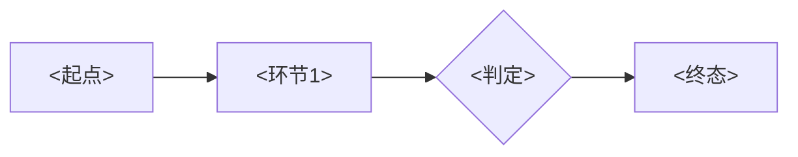
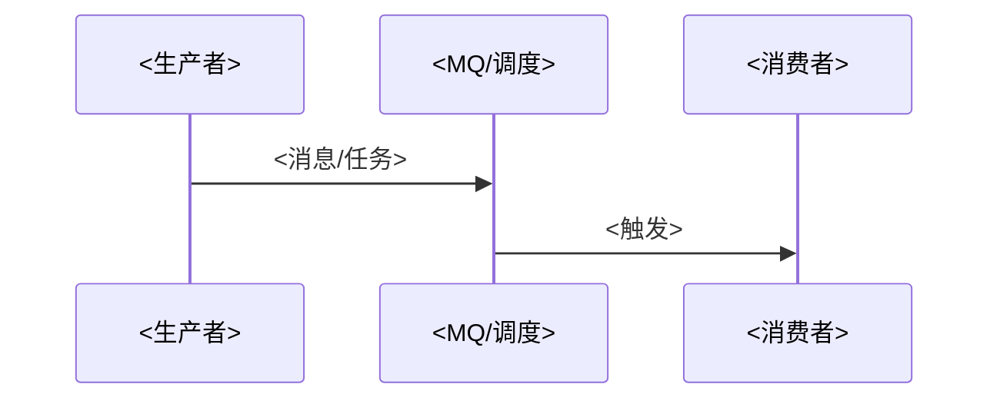
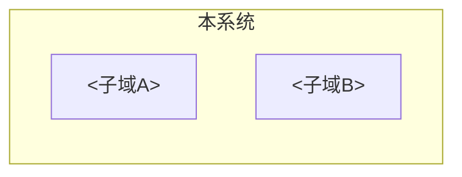
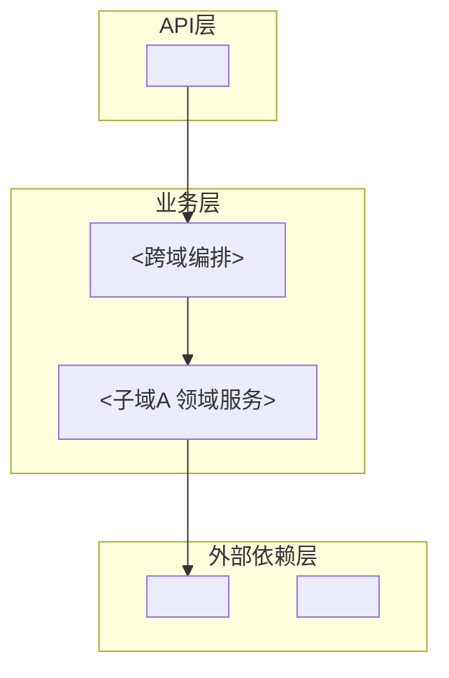
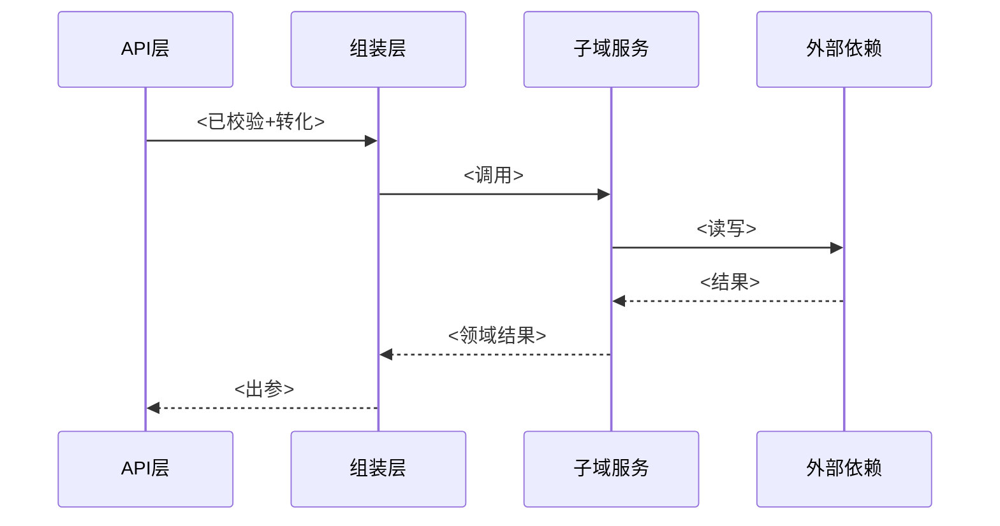

# 技术设计 — <需求标题>

> 只写最终态：过程、评审意见、被否方案一律进 `log/YYYY-MM-DD.md`。图优先，文字只做注脚。

## 术语表

| 术语 | 一句话解释 | 来源（PRD/代码/新造） |
| --- | --- | --- |
| <术语> | <人话解释> | <PRD / 代码 / 新造> |

## 一、需求背景

<背景与目标，≤5 句>

- 范围：<In Scope>；不做：<Out of Scope>
- 验收标准：见 `02-clarification.md`（AC-01 ~ AC-NN）

## 调用链路

| 上下游 | 协议 | 量级（QPS峰值/日均量） | 超时 | 降级 | 幂等 | 事务边界 | 依赖 SLO |
| --- | --- | --- | --- | --- | --- | --- | --- |
| <上游A → 本服务 / 接口名> | <HTTP/MQ/RPC> | <如 200 QPS> | <如 500ms> | <如 返回缓存> | <是/否 + 依据> | <本地事务/分布式，边界在哪> | <如 99.9%> |

不适用写「不涉及 + 理由」，留空会被 `design_lint` 拦。

## 二、业务流程

### 2.1 正向流程



### 2.2 逆向流程

<!-- 退款/取消/回滚/补偿；无则写「无」 -->


### 2.3 异步流程

<!-- MQ/定时任务/领域事件；无则写「无」 -->



### 2.4 上下游调用链路


## 三、领域划分

### 3.1 领域划分图



### 3.2 子域说明

| 子域 | 定位 | 划分依据 | 核心职责 |
| --- | --- | --- | --- |
| <子域A> | <定位> | <业务语义/变更频率/扩展方向> | <职责> |

## 四、实体设计

### 4.1 实体关系图

```mermaid
erDiagram
  <实体A> ||--o{ <实体B> : <关系>
```

### 4.2 实体说明

| 实体 | 所属子域 | 职责 | 关键属性 | 与其他实体的关系 |
| --- | --- | --- | --- | --- |
| <实体A> | <子域A> | <一句话> | <核心字段> | <如 1:N 关联实体B> |

## 五、数据建模

### 5.1 表关系图

```mermaid
erDiagram
  <table_a> ||--o{ <table_b> : "<外键关系>"
```

### 5.2 表：<table_name>

用途：<一句话>

| 字段 | 类型 | 说明 | 备注 |
| --- | --- | --- | --- |
| id | BIGINT | 主键 | 自增/序列 |
| <field> | <类型> | <含义> | <枚举口径/单位/默认值> |

| 索引名 | 字段 | 唯一 |
| --- | --- | --- |
| <索引名> | <字段> | <是/否> |

## 六、落地实现

分层与域间铁律见 `docs/ARCHITECTURE.md`；本节声明本需求的层序与模块归属。

### 6.1 分层架构图



### 6.2 数据流转图



### 6.3 接口契约

| 接口 | 方法 | 入参 | 出参 | 错误码 | 幂等性 |
| --- | --- | --- | --- | --- | --- |
| <路径/名称> | <GET/POST> | <参数> | <结构> | <错误码与含义> | <幂等机制> |

### 6.4 配置清单

<!-- 分界：需运行期调整→ducc；稳定值→properties；中间件参数→XML+properties -->

| 配置项 | 位置 | 默认值 | 用途 | 运行期可调 | 变更影响 |
| --- | --- | --- | --- | --- | --- |
| <配置项> | <properties/ducc/XML> | <默认值> | <用途> | <是/否> | <影响面> |

### 6.5 日志与链路

<!-- 日志刚需见 ARCHITECTURE：入口/外部调用/状态变更/异常/定时任务 traceId；这里写本需求的具体埋点 -->

| 位置 | 打印内容 | 级别 | 备注 |
| --- | --- | --- | --- |
| <入口/下游/定时任务> | <业务标识+关键入参> | <INFO/WARN> | <脱敏要求> |

## 复用论证

<!-- 新增 Service/Manager/Facade/Helper 逐个说明为何不能复用现有；缺这段 design_lint 报 major -->

| 新增类 | 为何不能复用现有 | 候选被否原因 |
| --- | --- | --- |
| <XxxService> | <一句话> | <现有 YyyService 为何不够> |

## 七、边界场景

| 场景 | 类型（边界/并发/幂等/超时/重试/重复投递/兼容） | 应对策略 |
| --- | --- | --- |
| <重复消息投递> | 幂等 | <唯一键/防重表> |
| <空值/极值入参> | 边界 | <API 层校验拦截> |

分布式落地：无状态方案 <…>；缓存选型 <…>；并发控制 <…>；定时任务 <…>（逐项填写，严禁单机假设）
