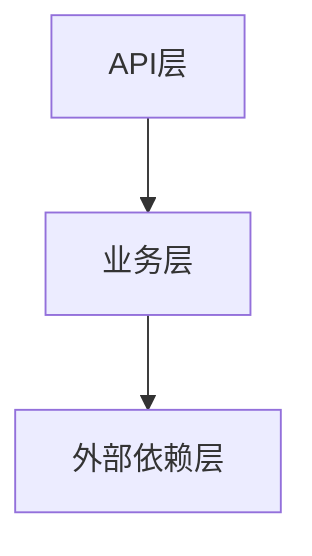

# 技术设计 — <需求标题>

<!-- 本文件对应需求档案中的 03-design.md，在设计阶段（designing）填写，评审通过（reviewed）后方可进入任务拆解。 -->

## 技术选型

<!-- 记录技术栈探测结论（从现有代码库探测到的语言/框架/依赖版本）与本次选型决策及理由。 -->

### 技术栈探测结论

| 项目 | 探测结果 |
| --- | --- |
| 语言/版本 | <如：Java 17> |
| 框架 | <如：Spring Boot 3.x> |
| 存储 | <如：MySQL 8 / Redis> |
| 其他依赖 | <关键库及版本> |

### 选型决策

<!-- 新增技术/库的选择及理由；优先复用现有技术栈。 -->

- <选型项>：<决策与理由>

## 领域模型

### 限界上下文划分

<!-- 列出识别出的限界上下文及其职责边界。 -->

- <上下文名称>：<职责>

### 聚合根 / 实体 / 值对象

<!-- 按聚合列出核心领域对象。 -->

| 聚合根 | 实体 | 值对象 | 说明 |
| --- | --- | --- | --- |
| <聚合根> | <实体> | <值对象> | <说明> |

### 领域事件清单

| 事件名 | 触发时机 | 订阅方 |
| --- | --- | --- |
| <事件名> | <触发时机> | <订阅方> |

### 领域模型图

<!-- 用 mermaid 绘制聚合/实体关系图。 -->

## 三层模块划分映射表

<!-- 将领域概念映射到落地模块。备注：API 层只做入参校验 + 防腐 + 参数转化；业务层承载全部业务逻辑，可再拆子层；外部依赖层只做转化 + 防腐，且足够通用（不含业务语义）。 -->

| 领域概念 | 落地层（API层\|业务层\|外部依赖层） | 模块 | 职责 |
| --- | --- | --- | --- |
| <领域概念> | <API层> | <模块名> | <职责> |
| <领域概念> | <业务层> | <模块名> | <职责> |
| <领域概念> | <外部依赖层> | <模块名> | <职责> |

## 架构图

<!-- 用 mermaid 绘制整体架构/调用关系图。 -->

## 数据模型

<!-- 列出表结构、字段与索引；涉及存量表的注明变更类型（新增表/加字段/改索引）。 -->

### 表：<table_name>

| 字段 | 类型 | 是否可空 | 默认值 | 说明 |
| --- | --- | --- | --- | --- |
| <字段名> | <类型> | <是/否> | <默认值> | <说明> |

| 索引名 | 字段 | 类型（唯一/普通） |
| --- | --- | --- |
| <索引名> | <字段> | <唯一> |

## 接口契约

<!-- 逐接口定义契约；错误码需覆盖异常场景清单（02-clarification.md）中的场景。 -->

| 接口 | 方法 | 入参 | 出参 | 错误码 |
| --- | --- | --- | --- | --- |
| <接口路径/名称> | <GET/POST/...> | <参数列表> | <返回结构> | <错误码与含义> |

## 边界定义

<!-- 四类边界必须显式定义，见 ARCHITECTURE.md 第六节；不允许留空，不适用须写明理由。 -->

| 边界类型 | 定义 |
| --- | --- |
| 上下文边界 | <各限界上下文的职责范围与协作方式（防腐层/领域事件）> |
| 接口边界 | <对外契约范围：哪些接口对外、幂等性约定、契约之外的隐式依赖声明为无> |
| 事务边界 | <每个核心流程的事务范围；跨上下文/跨库的最终一致性方案> |
| 数据边界 | <每张表/每份缓存的唯一写方上下文> |

## 分布式设计

<!-- 项目为云端分布式部署，严禁单机假设，见 ARCHITECTURE.md 第五节；逐项填写。 -->

| 维度 | 方案 |
| --- | --- |
| 服务无状态 | <状态外置方案；确认无 ThreadLocal/实例字段存会话状态> |
| 缓存选型 | <分布式缓存（Redis 等）；禁止本地内存当分布式缓存> |
| 并发控制 | <分布式锁方案；禁止 synchronized/ReentrantLock 保护跨实例资源> |
| 定时任务 | <分布式调度/抢占方案，避免多实例重复执行> |
| 幂等方案 | <接口幂等机制（唯一键/防重表/Token 等）> |

## 配置清单

<!-- 必填（HC-05/HC-12）：每项配置必须明确「放哪里 + 配置项名 + 默认值 + 用途 + 是否需运行期动态调整」。
     规则：静态配置（上限/阈值/超时/租户/别名/开关默认值等不常变动的）一律 properties 或中间件 XML；
     仅需运行期动态调整的（降级开关、运营开关）才放 ducc。禁止把不常变动的配置放 ducc。 -->

| 配置项 | 位置（properties / ducc / 中间件XML） | 默认值 | 用途 | 需运行期动态调整 | 变更影响 |
| --- | --- | --- | --- | --- | --- |
| <如 jsf.xxx.timeout> | <properties（被 xxx-consumer.xml 引用）> | <3000> | <下游调用超时> | <否> | <改后重启生效> |
| <如 xxx.switch> | <ducc> | <false> | <降级总开关> | <是> | <控制台改即生效> |

## 非功能需求

<!-- 逐项填写；无要求的项写明「无」。 -->

- 性能：<如：P99 < 200ms，QPS 目标>
- 安全：<如：鉴权、敏感数据加密、防注入>
- 兼容：<如：老版本接口/数据兼容要求>

## 风险初评

<!-- 初步识别技术风险；详细登记与跟踪见 10-risks.md。 -->

- <风险描述>：<初步应对思路>
