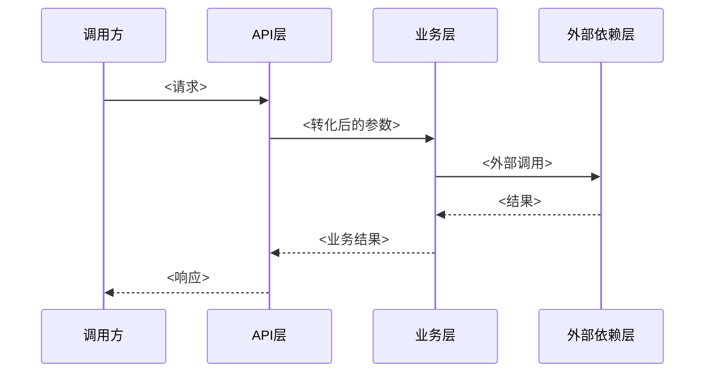

# 人工复验交接文档 — <需求标题>

<!-- 本文件对应需求档案中的 07-cr-handoff.md，在提交人工复验（cr-human）前由 Agent 填写。目标：让人工审查者不做全量审查，而是按本文档指引做精准抽查。填写质量直接决定人工复验效率。 -->

## 改动范围

<!-- 按功能域分组列出所有改动/新增的文件与模块；人工据此判断改动面。 -->

| 功能域 | 文件/模块 | 改动类型（新增/修改/删除） | 说明 |
| --- | --- | --- | --- |
| <功能域名> | <path/to/file 或模块名> | <修改> | <改动说明> |

## 入口清单

<!-- 列出本次改动涉及的全部外部入口，并标注从入口穿透到业务层/外部依赖层的路径；每个入口对应一条核心流程。 -->

| 入口类型 | 入口标识 | 说明 | 穿透层级 |
| --- | --- | --- | --- |
| <API路由\|页面路由\|消息消费\|定时任务\|事件监听> | <如：POST /api/orders> | <入口用途> | <如：API层 OrderController → 业务层 OrderService → 外部依赖层 PaymentClient> |

## 核心流程

<!-- 每个核心流程一个小节：mermaid 时序图 + 关键分支说明。 -->

### 流程 1：<流程名称>

<!-- 关联入口：<入口标识> -->

**关键分支说明**

<!-- 列出流程中的条件分支、异常分支及其处理路径。 -->

- <分支条件>：<处理路径>
- <异常场景>：<处理路径>

## 重点风险区

<!-- 标注需要人工重点关注的代码区域；类型取值：并发 | 事务 | 兼容 | 其他。 -->

| 风险点 | 类型 | 建议关注点 |
| --- | --- | --- |
| <位置/模块> | <并发\|事务\|兼容\|其他> | <具体建议，如：检查事务边界是否覆盖两次写操作> |

## Agent 已确认项清单

<!-- 列出 Agent 在 cr-agent 阶段已检查通过的项，供人工抽查而非全查；抽查不通过的项应整类复查。 -->

| 编号 | 检查项 | 检查方式 | 结果 |
| --- | --- | --- | --- |
| C-01 | <如：所有 API 入参均有校验> | <如：静态扫描 + 单测> | <通过> |
| C-02 | <如：DB 变更均有回滚 SQL> | <如：人工核对脚本> | <通过> |

## 人工复验结论

<!-- 由人工审查者填写。 -->

- 结论：<通过 / 打回>
- 打回原因：<如打回，列出具体问题及位置；须可执行、可验证>
- 审查人：<姓名>
- 日期：YYYY-MM-DD
